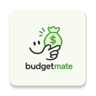

  
  <h1>BudgetMate</h1>
  
<strong>Native Android personal finance app for tracking income, expenses, subscriptions, and shared costs, with Material 3 design.</strong>

  

    <a href="https://github.com/Bagher010/BudgetMate/releases">Download the latest release</a>
  

  

    
    
    
    
  

  <a href="#features">Features</a> ·
  <a href="#technology">Technology</a> ·
  <a href="#privacy">Privacy</a>

---

## Features

- Record income and expenses with categories, then browse and edit transactions.
- Review balance, income, and expenses from the home screen.
- Explore spending summaries and statistics.
- Track subscriptions, billing cycles, and upcoming payments.
- Keep shared costs with contacts, including money lent, borrowed, and split.
- Configure available reminders and choose a light, dark, or system theme.

## Technology

- Kotlin
- Jetpack Compose and Material 3
- AndroidX Navigation
- Room for on-device finance records
- WorkManager for scheduled reminders

## Privacy

BudgetMate does not require an account. Finance records are stored locally on the device and are not sent to a BudgetMate server. See the [privacy policy](https://bagher010.github.io/BudgetMate-Privacy/) for details about stored data, backups, notifications, and deletion.

## License

BudgetMate is distributed under the [MIT License](LICENSE).
